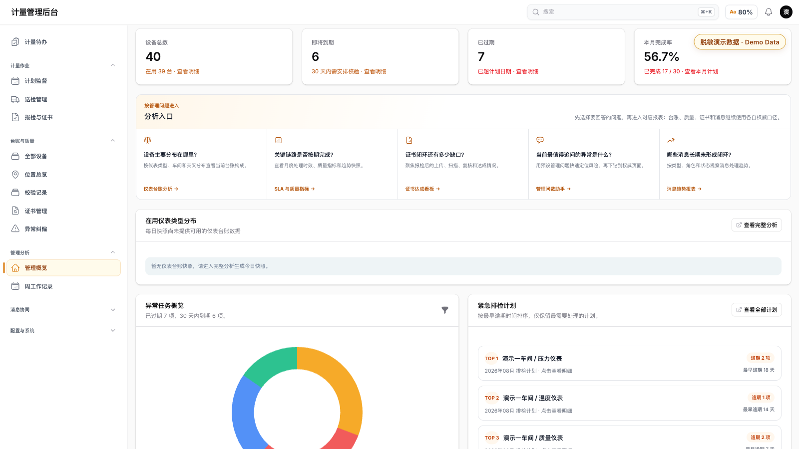

# 计量数字化管理作品集｜Measurement Portfolio

> 围绕计量设备送检、实物交接、证书复核与跨部门协作，把现场规则转成可执行的系统流程。主导现场需求、业务规则与验收，推进原型验证和流程落地。

[展示页](https://mrperfume.github.io/measurement-portfolio/) · [业务案例](docs/BUSINESS_FLOWS.md) · [工程证据](docs/ENGINEERING_EVIDENCE.md) · [GitHub Profile](https://github.com/MrPerfume)

## 我负责什么

- **需求梳理**：从送检、交接和证书复核中整理现场问题，明确角色分工与处理条件。
- **流程设计**：将预约安排、实物去向和证书结果分别记录，保留分批执行与人工确认过程。
- **验收验证**：通过合成案例和现有测试，检查数量、状态与操作记录是否一致。

希望继续参与设备与质量数字化管理、工业软件实施工作。

## 先体验一个案例

先看[三个代表案例](https://mrperfume.github.io/measurement-portfolio/#cases)，推荐从分批取回开始，再体验周报检与连续复核。

| 现场问题 | 我的处理 | 如何验证 |
| --- | --- | --- |
| 同批设备回计量室、部门直领或继续在检 | 逐台记录实际去向，保留未取回设备的在检状态 | [分批取回](https://mrperfume.github.io/measurement-portfolio/?scenario=returns#demo)：核对剩余数量与交接记录 |
| 一次报检分多次到场，排期还会调整 | 分别记录预约、到场与结果，改期保留原预约 | [周报检](https://mrperfume.github.io/measurement-portfolio/?scenario=weekly#demo)：检查改期和重复到场处理 |
| 连续复核多份证书，容易丢失处理进度 | 分开匹配建议、人工关联与复核完成，保留进度和待办 | [连续复核](https://mrperfume.github.io/measurement-portfolio/?scenario=certificate#demo)：检查重复确认、失败与返回后的上下文 |

首次体验可勾选一台设备 → 选择“取回计量室” → 登记 → 查看在检从 2 变 1 → 查看本次审计。已有操作时以当前明细为准；刷新恢复初始数据并进入链接指定场景，重置恢复默认场景。

完整演示包含六场景、两条分支和三个角色。详细规则、交互原型截图与原后台六图见[业务说明](docs/BUSINESS_FLOWS.md)。



## 验证与边界

公开演示只使用合成数据与页面内存，无登录、数据库、上传、接口、统计或持久化。固定演示时刻为 2026-09-07 17:00（北京时间）；角色是分工模拟，非身份鉴权。

10 月 11 日公开版本的验证为 **20 项 PHP／57 个断言、46 项 Node、48 项 Chromium**，见[历史交互验收](docs/INTERACTION_QA.md#mobile-feedback-20261011)；10 月 25 日内容更新检查见[对应记录](docs/INTERACTION_QA.md#practice-20261025)，不累计历次数量。PHP 验证既有领域内核，Node 与浏览器验证六场景、导航、任务引导和交接反馈，不代表生产收益、合规认证或完整系统全面验收。

## 近期业务实践（完整系统案例说明）

截至 **2026-10-25**，以下为完整系统的业务实践说明，六场景交互沿用 10 月 11 日版本。[直接看近期实践](https://mrperfume.github.io/measurement-portfolio/#recent-practice)；[发布记录](docs/ENGINEERING_EVIDENCE.md#当前发布记录)列出当次检查与实际发布状态。

- [使用部门按计划组协同与证书查询](docs/BUSINESS_FLOWS.md#department-portal-case)：按计划组申报数量，送检和领取分别跟进；按设备分组、分页查询证书历史。10 月 24—25 日相关版本部署测试站并补充归档。
- [检测单位排期与分组清单](docs/BUSINESS_FLOWS.md#mobile-plan-case)：人员与日期确认、计划组编排、版本冻结及分批执行。既有代表场景验收与后续功能进展分开记录。
- [原始检测记录与车间台账分离](docs/BUSINESS_FLOWS.md#inspection-record-case)：保留来源、历史设备身份与关联，分别管理原始记录、台账和送检轮次。
- [证书识别、登记与台账差异确认](docs/ENGINEERING_EVIDENCE.md#certificate-workflow-case)：PDF／OCR 辅助提取，先核对身份与日期，再预览差异、人工确认；执行时复查权限和并发变化，符合条件才可撤回。未识别与冲突项保留人工待办。

实际工作已有部分通知、查询与协同使用；新增代码、测试站交付和历史截图不证明全部新功能已实际使用，覆盖人数、设备量与节省工时仍未新增确认。原[部门进度通报案例](docs/BUSINESS_FLOWS.md#department-progress-case)及历史日期保留。

## 一次有边界的性能案例

2026-09-05 私有本地证书页对照：应用处理中位数 **584.23ms → 430.38ms，改善约 26.3%**。同环境、相同 20 行列表，每阶段首轮单列、后五次预热样本取中位数。优化范围是局部菜单渲染，保留权限判断。

这是公开不可复现的历史自述，不是生产收益、INP、P95 或 SLA，也不包括 OCR 或真实 PDF 解析。方法与限制见[工程证据](docs/ENGINEERING_EVIDENCE.md)。


## 本地预览

在仓库根目录执行：

```bash
bash scripts/build-pages.sh
php -S localhost:4173 -t .pages-dist
```

结束按 Ctrl+C。开发工具安装、测试和截图命令见[工程说明](docs/ENGINEERING_EVIDENCE.md#本地体验与验证)。

[架构](docs/ARCHITECTURE.md) · [状态测试](site/tests/) · [端到端测试](e2e/) · [公开边界与发布准备](docs/PUBLICATION_BOUNDARY.md) · [安全核查](docs/SECURITY_AUDIT.md) · [许可证](docs/LICENSE_AND_DATA_BOUNDARY.md)

许可证仅允许作品集查看与技术评估，不是开源许可证。完整系统的身份鉴权、并发数据库、真实消息、PDF/OCR 和部署不由本原型证明。
